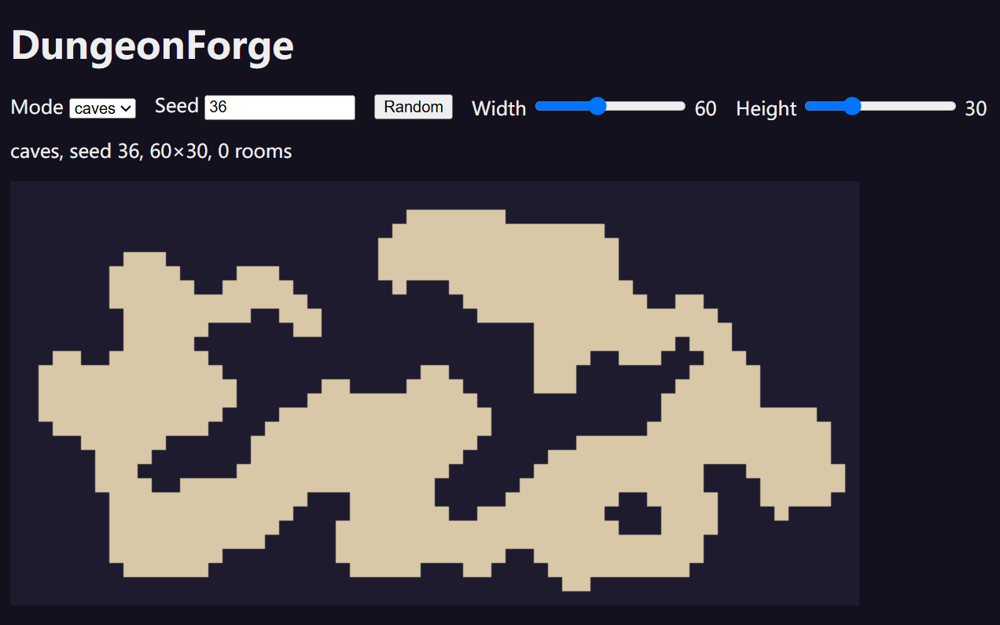

# DungeonForge


A procedural 2D dungeon generator in TypeScript. One pure, fully tested core library
powers a CLI, a React canvas viewer and an Express API, shipped as a single Docker image.



## Features

- **Two generators:** BSP rooms joined by L-shaped corridors, and cellular-automata caves
- **Deterministic:** a seeded PRNG (mulberry32), so the same seed gives the same map in Node and in the browser
- **Always connected:** BSP corridors form a spanning tree, caves keep only their largest region,
  and a BFS flood fill verifies connectivity across hundreds of seeds in the test suite
- **One core, three apps:** a CLI with validated flags, a React viewer with live controls,
  and an Express API with Zod-validated requests
- **115 tests**, strict TypeScript across 5 projects, and CI that builds and smoke-tests the Docker image

## Quick start

Requires Node 22.

```bash
npm install
npm run server   # API on http://localhost:3001
npm run dev      # web app on http://localhost:5173 (in a second terminal)
```

Generate a map from the command line:

```bash
npm run gen -- --mode caves --seed 36 --out maps/cave36.json
```

| Flag | Values | Default |
| --- | --- | --- |
| `--mode` | `bsp` or `caves` | `bsp` |
| `--seed` | whole number, 0 to 4294967295 | `42` |
| `--width`, `--height` | 10 to 200 | `60`, `30` |
| `--out` | file path for the JSON | not saved |

Run it the production way, with one server for the page and the API:

```bash
npm run build && npm start                                         # http://localhost:3001
docker build -t dungeonforge . && docker run -p 3001:3001 dungeonforge
```

## API

| Method | Path | Body | Response |
| --- | --- | --- | --- |
| `GET` | `/api/health` | none | `{ "ok": true }` |
| `POST` | `/api/generate` | `{ "mode", "seed", "width", "height" }`, same ranges and defaults as the CLI; every field optional | A `DungeonMap` as JSON |

Invalid input gets `400` with every problem listed; unknown fields are rejected:

```bash
curl -s -X POST http://localhost:3001/api/generate \
  -H "Content-Type: application/json" -d '{"mode":"lava","width":5}'
# {"error":"Invalid request","issues":[{"path":"mode",...},{"path":"width",...}]}
```

## Architecture

```text
dungeonforge/
├── packages/core   pure TypeScript: rng, grid, bsp, corridors, caves, validate (no I/O)
├── apps/cli        flags → validated config → map printed and saved as JSON
├── apps/web        React + Vite, draws the map on a <canvas>
└── apps/server     Express + Zod: the API, plus the built web app in production
```

`core` uses no Node or browser APIs, so the same code runs in all three apps. Its tsconfig
loads no Node types, so an accidental `fs` or `process` import fails to compile.

## How generation works

1. **BSP rooms:** recursively split the map into rectangles, place one room in each leaf,
   then join one room from each pair of sibling subtrees with an L-shaped corridor.
   That gives exactly rooms − 1 corridors: a spanning tree, so every room is reachable.
2. **Caves:** fill the map with 45% random wall, then smooth it 5 times with the 4-5 rule
   (a tile becomes wall with 5 or more wall neighbours, floor with 3 or fewer).
   Each pass reads the old grid and writes a new one. Finally a flood fill labels the regions
   and keeps only the largest, so no pocket is unreachable.

## Design notes

- **BSP vs naive placement** (40×20 map): similar room counts, but BSP takes 0.04–0.12 ms
  against 2–15 ms for rejection sampling, spreads rooms evenly, and its tree says which rooms to connect.
- **Fast enough to be live:** at the largest size (120×80), BSP takes about 0.5 ms and caves about 7.5 ms,
  so the viewer regenerates while you drag a slider. Stale requests are cancelled with `AbortController`.
- **No cache:** generation is deterministic and faster than a cache round trip, so the seed already is the cache key.
- **Validation at every boundary:** the CLI parses flags strictly, the API validates JSON with a Zod
  `strictObject`, and malformed requests get JSON errors, never a stack trace.
- **Container:** a multi-stage Docker build ships production dependencies only and runs as a non-root user.
  CI starts the image and checks the health endpoint, the page and a generated map on every push.

## Scripts

| Command | What it does |
| --- | --- |
| `npm test` | Run all 115 tests (Vitest) |
| `npm run typecheck` | Strict `tsc` on all 5 projects |
| `npm run dev` | Web dev server with hot reload (proxies `/api` to port 3001) |
| `npm run server` | API server that restarts on file changes |
| `npm run gen -- [flags]` | CLI generator |
| `npm run build` | Production build of the web app |
| `npm start` | Production server: API and web app on one port |

## Tech

TypeScript 7 · Node.js 22 · React 19 · Vite 8 · Express 5 · Zod 4 · Vitest 5 · GitHub Actions · Docker

## License

[MIT](LICENSE)
